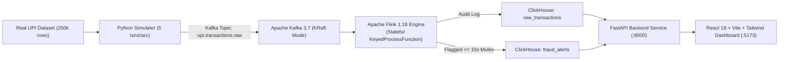

# Real-Time UPI & Mule Account Stream Detector

An enterprise-grade, distributed stream processing pipeline designed to detect **money mule networks**, rapid pass-through layering, and fraudulent transactions across UPI (Unified Payments Interface) payment streams in real time.

---

## Architecture Overview



---

## Key Features

1. **Sub-Second Detection Engine:** Apache Flink stateful stream processing tracks account inflow and outflow velocities via `ValueState` with a 15-second pass-through window threshold.
2. **Dual ClickHouse Storage:**
   - `raw_transactions` (`MergeTree`): Audits 100% of processed transactions with sender, receiver, bank, and location metadata.
   - `fraud_alerts` (`ReplacingMergeTree`): Stores flagged mule accounts with dynamic multi-hop transaction ID arrays.
3. **High-Speed Realistic Simulator:** Streams authentic UPI transactions at 5 txns/sec (`time.sleep(0.2)`) and periodically injects synthetic 3-hop laundering chains ($A \to B \to C \to D$) using realistic 10-digit VPAs.
4. **Interactive Enterprise Dashboard:**
   - 2-second glowing radar animation on initial load.
   - Split-screen interface: **70% Live Stream** table vs. **30% Fraud Alerts** feed.
   - **Hop Chain Modal:** Click any alert to inspect the reconstructed sequential hops with timestamps and amounts.
   - Light & Dark mode support with `localStorage` persistence.

---

## Tech Stack

| Component | Technology | Version | Description |
| :--- | :--- | :--- | :--- |
| **Broker** | Apache Kafka (KRaft) | `3.7.0` | High-throughput distributed message broker |
| **Stream Engine** | Apache Flink | `1.18.0` | Stateful stream processing (Java 11) |
| **Database** | ClickHouse Server | `24.3` | High-speed columnar OLAP storage |
| **Backend API** | FastAPI / Uvicorn | `Python 3.10` | REST API for alerts and live transactions |
| **Frontend** | React 18, Vite, Tailwind CSS | `5.x` | Enterprise dark/light dashboard |
| **Orchestration** | Docker Compose | `2.x` | Multi-container unified deployment |

---

## Quick Start

### Prerequisites
- [Docker Desktop](https://www.docker.com/products/docker-desktop/) installed and running.
- PowerShell (Windows) or Bash.

### Launch the Pipeline
Run the automated startup script:

```powershell
.\start.ps1
```

The script will automatically:
1. Verify the Docker daemon.
2. Compile the Flink streaming job Fat JAR using a containerized Maven image.
3. Launch all 7 core containers via Docker Compose.
4. Health-check ClickHouse and Flink TaskManager slots.
5. Submit the streaming detection job to Flink.

---

## Service Endpoints

| Service | Host Port | URL / Access | Description |
| :--- | :--- | :--- | :--- |
| **React Dashboard** | `5173` | [http://localhost:5173](http://localhost:5173) | **Sole exposed entrypoint**; proxies API calls internally |
| **FastAPI Backend** | Internal (8000) | `http://localhost:5173/transactions`, `/alerts`, `/stats` | Proxied through frontend on 5173 |
| **Flink Dashboard** | Internal (8081) | Internal container network (`jobmanager:8081`) | External host port closed for security |
| **ClickHouse HTTP** | Internal (8123) | Internal container network (`clickhouse:8123`) | External host port closed for security |
| **Kafka Broker** | Internal (9092) | Internal container network (`kafka:9092`) | External host port closed for security |

---
